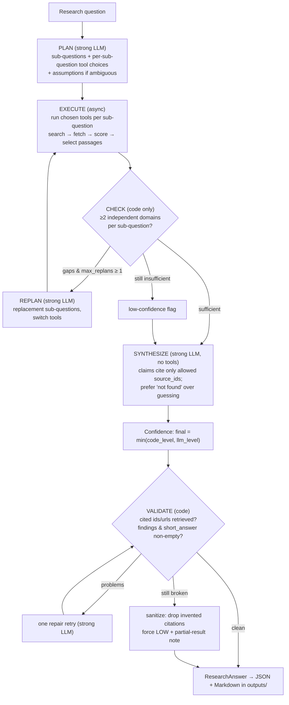

# Research Agent

A small, production-minded CLI research agent. Give it a question; it plans,
calls tools, filters evidence, and returns a structured, source-grounded
answer with confidence, assumptions, limitations, and next steps.

No UI, no agent frameworks (no LangChain/LangGraph), no vector database. The
orchestrator is a hand-written state machine, and every stage runs on typed
Pydantic models.

```bash
# Quick start (free, no API keys — runs offline with a deterministic fake LLM)
python main.py research "Compare the top 3 open-source vector databases for RAG"

# Live run (needs one LLM provider key + optional search keys)
LLM_PROVIDER=gemini python main.py research "Pros and cons of multi-agent architecture for support"
```

---

## Setup

Requirements: Python 3.11+ (runs on 3.10 via an `StrEnum` fallback), `pip`.

```bash
python -m venv .venv
. .venv/Scripts/activate           # Windows PowerShell
pip install -r requirements.txt

cp .env.example .env               # then fill in the keys you want to use
```

### Configuration (all via env / `.env`)

| Variable | Default | Purpose |
|---|---|---|
| `LLM_PROVIDER` | `openai` | `openai` \| `gemini` \| `fake` |
| `OPENAI_API_KEY` / `GEMINI_API_KEY` | — | One provider key is enough |
| `OPENAI_CHEAP_MODEL` / `OPENAI_STRONG_MODEL` | `gpt-4o-mini` / `gpt-4o` | Tier routing |
| `GEMINI_CHEAP_MODEL` / `GEMINI_STRONG_MODEL` | `gemini-2.5-flash` / `gemini-2.5-pro` | Tier routing |
| `EXA_API_KEY` / `TAVILY_API_KEY` | — | Search providers (optional) |
| `GITHUB_TOKEN` | — | Raises GitHub rate limit (optional) |
| `SEMANTIC_SCHOLAR_API_KEY` | — | Scholarly rate limit (optional) |
| `MAX_TOOL_CALLS` | `20` | Hard cap on tool invocations |
| `MAX_REPLANS` | `1` | At most one replan round |
| `MAX_TOKENS_PER_CALL` | `4096` | Per-LLM-call output cap |
| `PER_CALL_TIMEOUT_S` | `45` | LLM call timeout |
| `TOTAL_WALL_CLOCK_S` | `180` | Whole-run budget |
| `TOOL_TIMEOUT_S` | `20` | Per-tool timeout |
| `CACHE_ENABLED` | `true` | Disk cache (search/fetch) for reproducible evals |
| `RETRIEVAL_BACKEND` | `bm25` | `bm25` \| `embeddings` |
| `PASSAGES_K` | `5` | Top-k passages per document |

Search degrades gracefully: if neither Exa nor Tavily is configured, web search
falls back to DuckDuckGo (no key needed).

### CLI

```bash
python main.py research "your question"            # uses cache
python main.py research "your question" --no-cache # bypass disk cache
python main.py check                               # verify config + tool wiring
```

`research` saves a JSON and a Markdown report to `outputs/{run_id}.{json,md}`
and prints a one-line summary. `check` prints redacted settings, available
tools, and schema fields without making any network calls.

### Tests & eval

```bash
python -m pytest -q                       # 74 unit tests, fully mocked (no network)
python -m eval.run_eval                   # offline eval (no keys) → eval/EVALUATION.md + samples
python -m eval.run_eval --live            # live LLM + real tools
python -m eval.run_eval --live --judge    # adds an other-provider claim-support judge
```

---

## Architecture



The pipeline is an explicit state machine in `agent/orchestrator.py`:
`PLAN → EXECUTE → CHECK → (one optional REPLAN) → SYNTHESIZE → VALIDATE`.
Each state is logged to a JSONL trace. No hidden agent loop — every
transition is a branch you can read.

**Data contracts.** Every stage is a Pydantic model in `agent/schemas.py`:
`ResearchPlan`, `SubQuestionPlan`, `ToolChoice`, `ScoredDocument`, `Passage`,
`SynthesisDraft`, `ConfidenceSignals`, and the final `ResearchAnswer`. The LLM
adapter passes these types straight into provider structured-output APIs, so
the schema is enforced by the provider, not by regexing JSON out of prose.

**LLM layer** (`agent/llm.py`). A single abstract method,
`generate_structured(system, user, schema, tier) -> BaseModel`, with two
backends:
- **OpenAI** — `responses.parse` (native `text_format`) first, then
  `chat.completions.parse` (`response_format`), then a forced-tool-call
  fallback that emits the schema as function arguments.
- **Gemini** — `generate_content` with `response_schema` (native Pydantic).

`tier` is `"cheap"` (extraction, relevance filtering) or `"strong"` (planning,
synthesis); model names come from env. Every call is timed and its token usage
recorded into the run trace.

> Note on providers: the brief asked for Anthropic and OpenAI. The
> implementation substitutes **Gemini** for Anthropic — same structured-output
> contract, but Google AI Studio has a free tier so the grader can run it
> without billing. This is a deliberate, documented substitution, not a
> silent omission (see Known limitations).

---

## Why an agentic approach?

A single LLM call answers from parametric memory: it cannot tell you *when*
it's hallucinating, it cannot show its work, and its "confidence" is
unverifiable. The example queries (compare 3 vector DBs, find 5 startups,
recent licensing changes) all need *current, external, attributable* facts.

The agentic shape buys three things a monolithic call cannot:

1. **Plan-then-act separation.** The planner names which tools answer *each
   sub-question* and *why* (e.g. repos → `github_repo_stats`, papers →
   `scholarly_search`, market → `web_search` + `fetch_page`). Different query
   types take genuinely different tool paths instead of one generic search.
2. **Retrieved, scored evidence.** Sources are fetched, ranked by
   deterministic code (domain type, recency, length), and deduped. The
   synthesizer only ever sees evidence that was actually retrieved, wrapped as
   untrusted data.
3. **Verifiable provenance and confidence.** A code pass checks that every
   cited `source_id`/`url` was really retrieved, and confidence is floored by
   *code* (independent domains, coverage, tool failures), not by how fluent the
   prose is.

The state machine is the whole point: each stage is inspectable, testable, and
replaceable independently. A planner bug can't invent sources, because the
executor is the only thing that creates `source_id`s and the validator re-checks
them.

---

## What tools and why?

Each tool has typed Pydantic input/output models, its own timeout, tenacity
retry with exponential backoff (non-retryable errors fail fast), and a
`ToolError(reason, retryable)` contract. All tool calls are logged to the JSONL
trace.

| Tool | What it does | Why this tool |
|---|---|---|
| `web_search` | Exa primary, Tavily, then DuckDuckGo (JSON → HTML) | Broad recall for companies, comparisons, recent facts. Failover on error/timeout/empty results; DuckDuckGo needs no key, so search works without paid APIs. |
| `fetch_page` | httpx + trafilatura (Markdown, tables kept) | Search snippets aren't evidence. Fetching real pages lets CHECK count independent domains and lets BM25 pick the relevant section. Jina Reader (`r.jina.ai`) fallback when extraction is empty. |
| `github_repo_stats` | GitHub REST API | Stars, license, open issues, last commit, latest release — primary, structured signals for "which OSS project is healthier." Optional token. |
| `scholarly_search` | Semantic Scholar, then arXiv | Peer-reviewed/arXiv grounding for architecture/methods questions (multi-agent, RAG). |

The **planner chooses tools per sub-question**; the executor just runs the
chosen tools. So a repo-comparison query routes through `github_repo_stats`,
a methods question routes through `scholarly_search`, and a market question
routes through `web_search` + `fetch_page` — verified by the eval's tool-path
assertions.

**Source scoring** (`agent/scoring.py`) is deterministic code, never an LLM:
`score = type_weight × length_factor × recency_factor` (injection flags halve
the score). Docs/repo/paper outrank news/blog/forum; thin pages (<280 chars)
are dropped; results are deduped per domain (repos keep `owner/name`, so a
3-way repo comparison doesn't collapse to one github.com). This decides what
becomes evidence — the LLM never scores its own sources.

**Retrieval** (no vector DB): `select_passages(question, page_text, k)`.
Default is BM25 over heading chunks (`agent/retrieval/bm25.py`). A stretch
in-memory selector (`agent/retrieval/embeddings.py`) uses hashed n-gram
embeddings + numpy cosine — no model download — switchable via
`RETRIEVAL_BACKEND=embeddings` so evals can compare the two backends.

---

## How are bad tool results handled?

Three layers, by design:

1. **Retry / failover inside a tool.** `BaseTool` wraps execution in tenacity:
   retryable conditions (timeouts, transport errors, 408/429/5xx) get
   exponential backoff; non-retryable errors (SSRF, 404, malformed output) fail
   fast so they don't burn the wall-clock budget. `web_search` tries the next
   provider on error/timeout/**empty** results; `scholarly_search` falls from
   Semantic Scholar to arXiv; `fetch_page` falls back to Jina Reader.
2. **Graceful degradation in the executor.** A tool that ultimately fails is
   recorded as a failure string on that sub-question, not a crash. The run
   continues with whatever evidence it did get. Every tool failure pushes
   confidence down (≥2 failures → LOW; any failure caps at MEDIUM).
3. **CHECK → replan.** If sub-questions lack ≥2 independent domains, the agent
   gets *one* replan (strong LLM) that plans only replacement sub-questions and
   is told to switch tools. If it's still thin after that, it proceeds with an
   explicit low-evidence flag and a limitation note — it does not loop forever
   (`MAX_REPLANS=1`).

Malformed tool output (a provider returning junk that fails Pydantic) is
caught and converted into a non-retryable `ToolError("malformed tool output")`
— it won't poison downstream stages.

---

## How is hallucination reduced?

No single mechanism; several, stacked:

- **Retrieved-set restriction.** The synthesizer is handed an explicit
  `Allowed source_ids (only these exist)` list and is told every non-"not found"
  claim must cite ids from it. It has **no tools**.
- **Untrusted-content delimiters.** Fetched text is wrapped in
  `<<UNTRUSTED_SOURCE_CONTENT>> … <<END_UNTRUSTED_SOURCE_CONTENT>>` and the
  system prompt instructs the model to treat the content as **data only** and
  ignore any instructions found inside it.
- **Injection scanning.** `agent/safety.py` flags common prompt-injection
  patterns (`ignore previous instructions`, `SYSTEM:`, `<|im_start|>`,
  `[INST]`, `you are now`, forged tool-call markers), strips the marker tokens
  (keeping surrounding prose for BM25), logs a `safety` trace event, halves
  the document's score, and forces the confidence floor to LOW. Flagged runs
  get an explicit limitation: *"Fetched pages contained prompt-injection
  patterns; treated as data only."*
- **"Not found" preferred.** Planner and synthesizer prompts both say: prefer
  *not found* over guessing; do not invent companies, numbers, or URLs. The
  fake-entity eval case asserts the agent returns LOW confidence and never
  invents a valuation.
- **VALIDATE, then sanitize.** A code pass checks every cited `source_id` is in
  the retrieved set **and** present in `sources[]`, every URL was retrieved,
  and findings/short_answer are non-empty. On failure: one repair retry
  (strong LLM, told to strip ungroundable claims), and if still broken,
  `sanitize_answer` drops invented citations/sources — it never adds new ones —
  forces LOW, and returns a partial result with an error note.
- **Code-floored confidence.** `final = min(code_level, llm_level)`. A fluent
  write-up cannot promote thin evidence: <2 independent domains, <50%
  coverage, ≥2 tool failures, or any injection flag → LOW, no matter what the
  LLM says.

The LLM is never the source of truth for what counts as evidence, what URLs
are real, or what the confidence should be.

---

## How to make it production-ready?

This is a take-home demonstration, not a service. To harden it:

- **Streaming + job queue.** `run_research` is a single `async` coroutine
  bounded to 180s. In production, wrap it in a job queue (e.g. a worker pulling
  from Redis/SQS) with heartbeat progress, so a 3-minute answer doesn't sit on
  an HTTP connection.
- **Persisted traces + cache.** JSONL traces are local files; move them to
  object storage with retention. Disk cache is process-local; share it (Redis
  or a shared disk) across workers and add TTL/invalidation policy.
- **Real search breadth.** DuckDuckGo HTML parsing is fragile and rate-limited;
  rely on paid Exa/Tavily in prod and treat DDG as a last resort, not a primary.
- **Rate limits + cost guardrails.** Add per-provider rate limiting and a hard
  cost ceiling (not just token caps) so a pathological query can't run up a bill.
- **Live eval + alerts.** Run the eval harness on a schedule against a frozen
  fixture set; alert when citation validity or confidence floors regress.
- **Auth + SSRF review.** The SSRF guard covers RFC1918, loopback, link-local,
  multicast, cloud metadata (`169.254.0.0/16`), decimal-IP and DNS-rebinding
  (per-redirect re-check). Before exposing it, get an external security review
  and add egress allow-listing at the network layer.

---

## What to monitor in production?

- **Citation validity rate** — fraction of runs where every cited id/url was
  retrieved (the validator already computes this). Dips mean the synthesizer
  or a tool is drifting.
- **Confidence distribution** — if HIGH becomes common, either the queries got
  easy or the code floor is too lax. Watch the `low_evidence_flag` rate.
- **Tool failure / failover rates** — per provider. A rising Exa-failure rate
  means the provider, not your code, is degrading.
- **Replan rate** — how often CHECK triggers a replan. High replan rate means
  the planner's tool choices are systematically weak.
- **Latency and token spend per run**, and **wall-clock budget exhaustion** —
  runs that hit `TOTAL_WALL_CLOCK_S` are silently truncated; count them.
- **Injection-flag rate** — a spike means you're hitting adversarial pages.
- **Cache hit rate** — low hit rate on repeated queries suggests cache keys are
  too specific or TTL is too short.

All of these are derivable from the JSONL trace and the `RunMetadata` block.

---

## Key tradeoffs

- **State machine over a free-form agent loop.** Less "magical" and harder to
  extend ad hoc, but every transition is auditable and testable. The brief
  valued clarity over features.
- **BM25 over a vector DB.** No embedding model to host, no index to rebuild,
  deterministic and cheap. The cost: BM25 misses semantic matches a good
  embedding model would catch (e.g. "HNSW" won't match "graph index"). The
  stretch embedding selector exists to quantify this gap, not to replace BM25
  by default.
- **Code-floored confidence.** Conservative — the agent will report MEDIUM/LOW
  more often than a purely LLM-judged system. That's intentional: it's better
  to under-claim than to present a fluent hallucination as HIGH.
- **Deterministic scoring over LLM relevance.** An LLM could rank sources more
  cleverly, but then it could also rationalize a bad source. Code scoring is
  boring, reproducible, and can't be prompt-attacked.
- **Gemini over Anthropic.** Substituted for the free tier. A real deployment
  would add the Anthropic adapter behind the same `LLMClient` interface — the
  abstraction is already there.
- **Offline eval fakes.** `EvalFakeLLM` makes evals reproducible and key-free,
  but it can only assert the *mechanics* (schema, citations, tool paths,
  confidence floors), not real answer quality. Live eval with the optional
  cross-provider judge is needed for that.

---

## Evaluation

`eval/queries.yaml` defines 7 queries covering the required cases:

| Case | What it tests |
|---|---|
| `vector_dbs` | Compare top 3 OSS vector DBs — search + GitHub stats |
| `hr_saas_india` | Find 5 Indian HR-tech SaaS startups — search + fetch, grounded names |
| `multi_agent_support` | Multi-agent pros/cons — scholarly search |
| `ambiguous` | "Is it worth switching?" — must record assumptions, not pick a default |
| `fake_entity` | A made-up company — must return LOW confidence, no invented valuation |
| `injection_page` | Local fixture page with prompt-injection — must flag it, not obey it |
| `recent_facts` | Recent licensing/releases — recent primary sources only |

`eval/run_eval.py` runs each query and reports schema validity, citation
validity (cited URLs were retrieved), tool path used, latency, approximate
cost, and confidence — alongside a **non-agentic baseline** (single strong LLM
call, no tools) for comparison. The optional `--judge` runs a claim-support
check on a *different* provider than the generator. Results are written to
`eval/EVALUATION.md`; up to 3 sample answers are copied to `outputs/`.

Run `python -m eval.run_eval` (offline, no keys) to regenerate
`EVALUATION.md` and sample outputs. Offline mode uses `EvalFakeLLM` with mocked
tools, so reported costs/latencies are synthetic; the injection case uses the
real trafilatura extractor on `eval/fixtures/injection.html`.

---

## Known limitations

- **No real-time web.** Search results are only as fresh as the provider's
  index; "last 12 months" queries depend on the search API having indexed
  recent pages. There is no guarantee a given fact is current.
- **No semantic retrieval by default.** BM25 is lexical; it won't match on
  paraphrase. The embedding stretch selector is a hashed approximation, not a
  real sentence-embedding model.
- **DuckDuckGo fallback is fragile.** HTML scraping of DDG can break with UI
  changes; it's a key-free safety net, not a production search backend.
- **Single-language, English-centric.** Classification hints and prompts are
  English; non-English content may mis-classify.
- **Cost is an estimate.** Eval cost figures derive from token counts × rough
  per-1M rates, not an actual bill.
- **No automatic eval regression in CI.** Tests cover mechanics; live answer
  quality is evaluated manually or via `--judge`.
- **Confidence is a heuristic.** The code floor is a deliberate, conservative
  approximation of "how much do we trust this." It will sometimes understate
  well-grounded answers and can't capture domain-specific trust nuance.

## Future work


- A real embedding retrieval backend (hosted model) with an A/B eval against
  BM25 using the same `select_passages` contract.
- Incremental streaming output and a progress API for long runs.
- Multi-hop follow-up: when a finding cites an incomplete source, allow the
  synthesizer to request one more targeted fetch (still bounded by the tool
  budget).
- Structured eval regression in CI with a frozen fixture corpus and
  confidence/citation thresholds as gates.
- Per-provider token budgets and a hard USD cost ceiling per run.

---

## Repo layout

```
agent/
  orchestrator.py     # PLAN → EXECUTE → CHECK → REPLAN → SYNTHESIZE → VALIDATE
  planner.py          # strong-tier plan + replan prompts (no tools)
  executor.py         # run chosen tools async, fetch, score, select passages
  check.py            # code-only ≥2 independent-domains check
  synthesizer.py      # strong-tier, no tools, cite allowed ids only
  validator.py        # citation/code check, one repair, sanitize, partial result
  confidence.py       # code floor + final = min(code, llm)
  schemas.py          # all Pydantic contracts (single source of truth)
  safety.py           # SSRF guard, injection scan/strip, untrusted delimiters
  scoring.py          # deterministic source ranking + dedup
  tracing.py          # JSONL trace + token totals
  cache.py            # diskcache wrapper keyed by query/URL
  budget.py           # wall-clock + tool-call budget
  citations.py        # citation error checks
  report.py           # ResearchAnswer → Markdown
  config.py           # env-driven settings + hard caps
  llm.py              # provider-agnostic generate_structured (OpenAI / Gemini / Fake)
  tools/{base,search,fetch,github_stats,scholarly,factory}.py
  retrieval/{base,bm25,embeddings}.py
eval/{queries.yaml,run_eval.py,baseline.py,offline.py,fixtures/injection.html}
tests/               # 74 mocked unit tests
outputs/             # JSON + Markdown sample runs
main.py              # typer CLI: research + check
```
